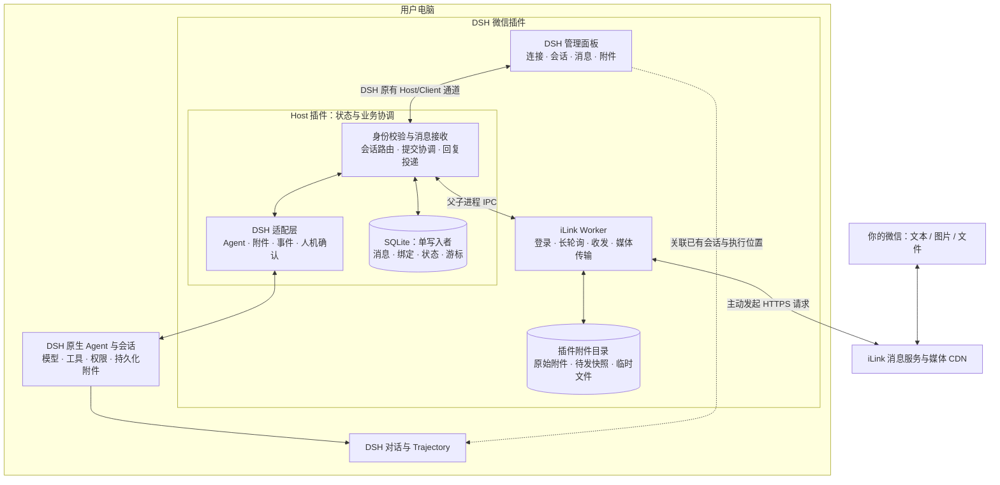

# DSH 个人微信通道插件设计方案

状态：方案已获用户批准并进入实现。实现范围、目标版本差异及验证状态见 [实施记录](../runbook/implementation.md)。本文保留设计契约，不能视为所有验收已完成。
日期：2026-09-11。暂定包名：`dsh-wechat-channel`，发布名称实施时确定。

## 1. 术语

| 术语 | 定义 |
| --- | --- |
| DSH Host | 电脑上实际运行 DSH 服务和 Agent 的进程；插件安装在此进程的 profile 中 |
| 通道 | 微信作为输入、输出和人机确认入口 |
| 微信绑定 | 一个 iLink bot 账号与唯一允许操作它的微信身份之间的关系 |
| 会话绑定 | 微信入口指向一个明确的 DSH session；与微信账号登录分开管理 |
| 入站消息 | 微信已传来的一个完整消息，含有序的文本、图片、文件内容 |
| Submission | 插件将一条入站消息交给 DSH 的持久化提交记录 |
| Outbox | 等待发往微信的持久化投递记录 |
| Trace | DSH 已有的执行轨迹；插件通过 session、message、turn 和事件位置关联 |
| 投递成功 | iLink API 明确接受消息，不等价于用户已读 |

## 2. 需求概述

### 2.1 已确认需求

用户通过手机微信与自己电脑端的 DSH 交互。第一版必须支持：

1. 单人绑定；其他微信身份不能查询或驱动 DSH。
2. 文本、图片、文件双向收发，允许无文字的纯附件消息。
3. 微信消息、附件、会话映射和投递状态持久化。
4. DSH 内提供连接管理、消息与附件记录、执行关联的可视化界面。
5. 复用 DSH 的 Agent、会话、模型、工具、权限和 Trace。
6. 独立实现。不得 import、复制或移植 `lanbaolu/dsh-wechat-bridge` 的代码，也不将它作为直接、间接或运行时依赖。

第一版同时纳入停止任务和微信确认操作，以保证远程任务可以结束或继续。多用户、群聊、语音转写、视频专用处理、云端中继、多电脑路由、定时主动推送、自建 Agent Runtime 和 Trace 系统不在本期范围。普通文件包含任意二进制文件，但不承诺模型能理解所有格式。

### 2.2 部署前提与实现基线

- 电脑和 DSH Host 持续运行；不自动修改系统休眠策略，不承诺离线执行。
- 插件与目标 DSH 共用同一 Host。单纯读取另一进程的会话文件不能实现实时会话共享。
- 只绑定一个 bot 和一个 owner；一次只有一个当前目标会话，允许显式切换。
- 源码研究基线：DSH 官方仓库 commit `c291e7961a515f6d7af9304e7fd1d257929aef26`，下称 **S1**。这是设计证据基线，不等于已确认的用户运行版本。
- 本机一个已有 npm 缓存中的 `dsh`、`dsh-agent`、`dsh-attachment` 均为 `0.1.1-rc.2`；只读了包清单，未确认当前桌面实际加载版本。
- iLink 协议参考为 npm 发布包 `@tencent-weixin/openclaw-weixin@2.4.8` 的 API、消息类型和 CDN 实现；下称 **S2**。仅用于协议调查，不加载 OpenClaw，也不作为运行依赖。发布包不等价于稳定的独立 iLink SDK 契约。

### 2.3 必须在实施阶段关闭的核验项

| 编号 | 核验内容 | 未满足时的行为 |
| --- | --- | --- |
| G1 | 目标 DSH 版本具备活跃 Agent 获取、持久化 Inbox、附件服务及扩展入口 | 报兼容性错误，不猜测接口或启动替代 Agent |
| G2 | iLink 登录返回身份、消息唯一键、媒体上传下载和回复上下文的真实行为 | 对不确定身份关闭消息执行；不承诺不重复投递 |
| G3 | 目标 DSH 中 MessageId 的构造、历史查询、提交持久化边界和 turn 关联 | 无法证明提交状态时标记待核对，不自动重跑 |
| G4 | 微信与桌面共用活跃 Agent、审批及用户问题的 handler 顺序 | 不开启共享会话的远程执行，先完成协调验证 |
| G5 | DSH 对话/Trajectory 的公开导航方式 | 至少展示 session、turn 并能定位会话；精确跳转能力单独标明 |

上述是技术接入核验任务，不需要用户重新决定已确认的产品范围。方案可以进入实现，发布验收须关闭 G1–G5。

## 3. 总体设计

### 3.1 架构

交付一个 npm 插件包，包含 Host 入口、Client 管理面板和受 Host 管理的 iLink Worker。采用 TypeScript；Node 版本、DSH peerDependencies 和 SQLite 驱动在 G1 确认后锁定，CI 使用同一版本。



Host 是 SQLite 唯一写入者，Worker 只处理 iLink I/O。Worker 通过 IPC 提交收到的消息批次，收到 Host 的落库确认后才能使用新同步游标。管理面板复用 DSH 客户端通信，不开独立网站或公网端口。

### 3.2 关键决策及原因

| 决策 | 原因与取舍 |
| --- | --- |
| 复用活跃 Agent | S1 的 `ctx.agents.get(sessionId)` 可返回现有 Agent；桌面与微信进入同一 DSH Inbox，由 DSH 串行执行 |
| Worker 与 Host 分进程 | 网络和媒体故障可独立重启；代价是需要 IPC 协议。生命周期仍依附 Host，不另装系统守护服务 |
| 父子进程 IPC | 仅有一个受管 Worker，无需本机 HTTP/SSE 服务和额外端口、token 管理；大文件只传引用、不传大字节串 |
| Host 单写 SQLite | 消息、游标和投递状态可在一个事务里变更；避免 Worker 与 Host 分别维护“真相” |
| 原生 DSH 附件引用 | 保留 DSH 历史与模型附件输入能力；插件原始文件用于通道审计，两类存储清理规则独立 |
| 原生 Trace 关联 | 插件只解释消息在哪一环节失败，不复制工具调用、模型过程和完整 Trace |
| 只转发微信触发的执行结果 | 同一 DSH 会话中桌面发起的其他 turn 不自动推给微信，避免重复和错误关联 |

### 3.3 正常业务流

扫码登录 → 确认唯一 owner → 在面板选择项目与会话 → 微信发消息 → Host 持久化 → 附件就绪 → 提交 DSH Inbox → 关联 DSH turn → 接收持久化结果 → 生成 Outbox → iLink 发送 → 面板展示 API 接受状态。

同一条消息的路由在入站落库时固定到 `bindingRevision + dshSessionId`。此后切换目标会话只影响新消息，不能将排队消息悄悄改投。

## 4. 详细设计

### 4.1 模块与建议目录

```text
src/
  host/index.ts              # 注册服务、生命周期、Client API
  client/                   # 管理面板
  application/              # 接收、提交、对账、投递、切换会话
  domain/                   # 数据类型与状态转换规则
  adapters/dsh/             # 唯一允许直接依赖 DSH SDK 的业务适配目录
  adapters/ilink/            # 独立实现的协议、登录、媒体处理
  infrastructure/sqlite/    # 事务、查询、迁移
  infrastructure/files/     # 暂存、哈希校验、安全读写
  worker/                   # IPC 与受管 I/O 循环
tests/
  unit/
  integration/
  e2e/
```

模块职责：application 依赖自有 Port；DSH 与 iLink 变更集中在各自 adapter；持久化与媒体模块不调用 Agent。第一版单包构建，避免提前拆分多个发布包。

### 4.2 登录、单人绑定与凭证

连接状态：`unbound → pairing → connected ↔ reconnecting → auth_required`，用户停用后为 `stopped`。面板关闭不影响 Host 和 Worker。

扫码登录 bot 身份与确认 owner 是两个步骤。优先使用协议明确返回且经真实验证的 owner 身份。若登录结果无法证明 owner，则仅在电脑端人工开启的短期配对窗口接收候选请求，要求微信发送面板上的随机一次性配对码，再由面板确认身份；不能自动相信第一位发消息的人。

每次入站校验 bot、owner、私聊类型及账号代际 `accountEpoch`。拒绝群聊及未知用户，不把其内容交给 DSH。解绑递增 epoch、停止 Worker、删除凭证和回复上下文、取消未发消息；历史只读保留，新绑定不得继承旧账号待发消息。

凭证优先使用目标 DSH 已验证的凭证存储服务；若不具备合适的使用方式，使用仅当前系统用户可读的独立凭证文件（macOS/Linux 0600，Windows 用户 ACL）。凭证、context_token、CDN 签名 URL、解密密钥不进入日志、Trace 或面板响应。需要延迟处理的敏感媒体描述符须加密存储，密钥与数据库分离。

### 4.3 入站处理与附件就绪

1. Worker 从 Host 取得已提交游标，发起长轮询。
2. 将响应批次、旧游标、新游标与 epoch 交给 Host。
3. Host 事务内检查 epoch 和旧游标，按协议稳定 ID 去重，保存完整业务消息及加密媒体描述符，写入待处理状态，最后更新游标。
4. Host 返回确认后，Worker 使用新游标继续轮询。崩溃重放由唯一约束消重。
5. 附件异步下载至生成名称的 `.part` 文件；完成大小和完整性检查后原子改名。Host 持久化附件元数据。
6. 经 DSH 附件服务保存并获得引用；所有必需附件就绪后，消息才能进入提交队列。

没有稳定消息 ID 的协议输入进入 `quarantined`，保留排查信息但不自动执行。不能仅以文本哈希消重，因为相同文本可能是两次有意请求。`message_id` 的唯一范围和数字精度在 G2 核验；必要时使用无损 JSON 解析，内部存字符串 ID。

消息状态：`received → preparing → ready → handed_off`；异常为 `attachment_failed / unsupported / quarantined / cancelled`。附件失败保留可重试入口，不能静默去掉附件后只提交文本。

每个绑定按持久化的 `ingress_order` 顺序交接普通消息。前一条图片仍在下载时，后一条解释文字即使已 ready 也不能越过；若前条附件失败，暂停该绑定后续普通提交，直到重试成功或用户明确取消失败消息。控制指令不受此队列阻塞。多个附件可以并行准备，但交接顺序不能由下载完成时间决定。

纯图片或纯文件也产生正常提交。多个独立微信消息逐条形成 turn，不根据时间猜测“上一张图片和下一句文字属于同一消息”；DSH 会话上下文自然承接。用户可在图片到达后继续发送解释。

### 4.4 会话绑定与 DSH 接入

面板展示目标 Host 内可选项目与会话；确认后保存 `workspaceId / dshSessionId / bindingRevision`。默认只选择或新建会话，不自动跟随桌面焦点。

解析会话的顺序：

1. `ctx.agents.get(sessionId)` 有结果：借用该 Agent，不能 dispose 它。
2. 没有活跃 Agent：用 `ctx.agents.resume()` 恢复；插件记录自己持有的 Handle。
3. get/resume 存在创建竞争：遇到占用错误重新 get，不创建同 ID 的第二个实例。
4. 指定会话不存在或损坏：显示错误，要求显式选新会话，不偷偷创建空会话替代。
5. 只有用户选择“新建会话”才调用 `create()`。

普通消息通过 `followup()` 进入 DSH 持久化 Inbox，不将普通微信消息解释为 `steer()`。插件队列处理身份、附件就绪与可靠交接；DSH Inbox 负责已交接消息与桌面输入的实际执行顺序。

每条 Submission 固定 DSH MessageId。S1 的 Inbox 对 MessageId 有一致性约束，但这不自动证明外部提交全程幂等，因此必须实现下节的对账。

### 4.5 提交、对账与结果关联

Submission 状态：

```text
prepared → submitting → accepted → running → completed / failed / cancelled
                    ↘ uncertain → 对账后进入确定状态
```

`accepted` 表示已确认进入 DSH 持久化记录，不以 `followup()` 的 void 返回值作为跨进程 durable ACK。适配层根据目标版本的 Inbox 插入记录或 session 持久化查询证明接受，再更新 Submission。

DSH 与 SQLite 之间没有分布式事务。Host 在提交后、更新 SQLite 前崩溃时，通过预先保存的 MessageId 查询 DSH Inbox、已消费输入及会话日志：

| DSH 查询结果 | 动作 |
| --- | --- |
| 仍在 Inbox | 标记 accepted，等待 DSH |
| 已与 turn 关联 | 恢复 running 或终态，不再次提交 |
| 存在持久化结果 | 补建 Outbox，以 DSH 结果来源唯一键消重 |
| 可以证明未接收 | 在同一会话和 MessageId 下重新提交 |
| 无法证明 | 标记 uncertain，暂停该提交，面板显示“执行状态待核对” |

通过 `agent/inbox/claimed` 建立 MessageId 与 turn 的关联，并结合持久化用户消息/事件对账。DSH status/idle 不能代替单条 Submission 完成证据，因为同一 Agent 可能继续处理桌面消息。

S1 的 `agent/assistant-stream` 是临时展示流，最终内容落在持久化 `assistant/message` 或 `assistant/attempt`；持久化日志是恢复来源。微信第一版发送有节制的任务状态和持久化最终结果，不将所有 token 或工具输出推给手机。终态以实际持久化 turn 结束记录判定，不以“即将停止”事件判定。

维护 `lastProcessedDshSeq`。消费结果事件与创建 Outbox 在同一 SQLite 事务中提交；重放事件不会重复生成待发记录。结果唯一键建议为 `(epoch, sessionId, sourceEventSeq, partIndex, purpose)`。

### 4.6 图片与文件

**入站图片**：iLink/CDN 下载并按协议解密 → 校验原始内容 → `ctx.attachments.saveImage()` → `ImageAttachmentRef` → DSH 消息的 image part。模型是否支持视觉由 DSH 路由决定；不支持时明确报错，不把文件路径当作成功的视觉输入。

**入站文件**：流式下载 → 完整性校验 → `ctx.attachments.saveFileStream()` → `FileAttachmentRef` → DSH 消息的 file part。S1 将通用文件投影为供工具按需读取的保存路径，不表示文件内容被直接塞进模型。文件格式理解、PDF 解析等由 DSH 工具和模型处理。

**出站附件**：注册一个受 DSH 权限约束的 `wechat_send_attachment` 工具，接受 `{ submissionId, path, caption? }`。只允许与当前微信 Submission 关联的 Agent 调用；在 Host 内解析真实路径、检查普通文件与允许目录、拒绝符号链接越界，复制成不可变发送快照。工具返回“已排队”及 deliveryId，不能在 iLink 接受前声称已发送。

工具调用以 DSH toolCallId 加附件内容哈希生成去重键，防止工具恢复时重复排队。默认允许目录为目标工作区和显式配置的产物目录；附加目录必须由电脑端用户配置。插件不解析回复中的任意路径自动发送文件。

图片走原生图片发送，文件走原生文件发送；文本中的 Markdown 本地链接不等价于发送附件。媒体上传成功但消息未发出时保留有效上传凭据；失效后可重新上传，不把上传完成当作用户收到文件。

建议初始资源策略（本插件限制，非 iLink 已确认上限）：单张源图片 20 MiB、单文件 100 MiB、媒体并发 2、插件目录配额 2 GiB。实际允许值取插件、DSH、协议三者最小值；图片像素与解码限制交给 DSH。达到配额暂停新附件并明确提示，不自动删除仍被任务或 Outbox 引用的文件。

文件保存用生成的 ID，原始名称只作显示；下载防越界、防任意 URL 请求和无限响应流。CDN host/redirect 规则按 G2 确认后收敛为允许列表，不跟随任意重定向。预览仅允许受支持的栅格图片，HTML/SVG 等主动内容按附件下载处理。

### 4.7 回复投递与语义边界

Outbox 状态：`queued → sending → sent`；失败进入 `retry_wait / waiting_context / uncertain / failed / cancelled`。

- 每次发送保存稳定 `clientId`，按照实际协议的文本长度限制分片；分片顺序在落库时固定。
- 同一会话的回复按序发送，后续分片不越过前一失败分片。审批与取消状态使用独立控制优先级，不能被大文件阻塞。
- 明确的可重试失败采取指数退避和抖动，例如 1、2、4、8 秒至最多 60 秒，尊重服务端退避要求。默认最多 8 次，之后需人工重试。
- context_token 失效进入 `waiting_context`，等待同一 owner 的新消息刷新后再发；凭证失效则要求重新扫码。
- 请求可能已被服务端接受但响应丢失时进入 `uncertain`。只有 G2 证明 clientId 幂等或存在投递查询能力，才自动安全重发；否则面板允许人工“重新发送”，提示可能重复。
- 面板用“微信接口已接受”描述 sent，不展示未经证实的“已读”。

不承诺端到端 exactly-once。目标是入站不丢已确认批次、DSH 提交可对账、Outbox 不丢、遇到不确定结果不盲目重复执行。

### 4.8 停止任务与人机确认

支持 `/status`、`/stop`、`/help`；会话切换第一版在面板完成。`/stop` 只针对当前绑定内由微信发起的工作：删除该绑定尚未提交的插件消息；移除其 DSH 待处理 MessageId；如果当前执行 turn 属于微信 Submission，取消活动并尽量保留其他输入。桌面发起的活动 turn 不自动取消。精确取消选项以 G1 验证结果为准。

通过 DSH `approval/request` 和用户问题服务接入。仅在已确认由微信发起的 turn 内接管人机请求，否则调用下一处理者。审批保留 DSH 原有 policy，插件不提升权限、不自动同意。

每个请求生成短编号并绑定 `(epoch, owner, session, submission, requestId)`，微信使用 `/approve 编号`、`/deny 编号`；问题使用 `/answer 编号 内容`。不使用无编号的“是/否”猜测目标。默认有效期 5 分钟，过期、取消、解绑、Host 重启后不接受旧请求。

第一版采用单一裁决入口：微信 turn 的确认由插件协调器持有，插件面板镜像同一请求，微信和面板首先有效的答复生效；其他 DSH turn 沿原有桌面路径。需验证 handler 优先级，不能两个 listener 各自等待并同时决定。恢复时持久化记录仅用于展示，不能重建已经消失的 Promise 或复用旧审批。

### 4.9 数据模型

SQLite 启用外键、WAL 和显式事务；成功 ACK 依赖已提交持久化写入，采用适合该保证的同步策略。采用 schema_version 顺序迁移。UUID/ULID 用于本地 ID，时间为 UTC 毫秒，协议游标不解析。

| 表 | 主要字段与约束 |
| --- | --- |
| accounts | id、epoch、bot_id、owner_id、credential_ref、state；只有一个启用账号 |
| channel_state | account_id、epoch、poll_cursor、context_cipher、context_updated_at；账号与代际唯一 |
| bindings | id、account_id、epoch、revision、workspace_id、dsh_session_id、active；仅一个当前绑定，历史不可改写 |
| messages | id、epoch、direction、provider_message_id、binding_id、ingress_order、received_at、content_json、state；入站稳定协议 ID 唯一，绑定内入站顺序唯一 |
| attachments | id、message_id、part_index、display_name、mime、size、sha256、blob_key、sensitive_descriptor_cipher、dsh_ref_json、state |
| submissions | id、message_id UNIQUE、dsh_session_id、dsh_message_id UNIQUE、binding_revision、turn_no、state、error_code |
| outbox | id、epoch、submission_id、message_id、source_key UNIQUE、payload_json、client_id、state、attempts、next_attempt_at、last_error |
| interactions | id、submission_id、dsh_request_key、kind、display_payload、state、expires_at、resolved_by |
| session_checkpoints | epoch、dsh_session_id、last_processed_seq；复合唯一 |
| channel_events | 自增 seq、entity_type、entity_id、state、error_code、occurred_at；驱动面板增量更新 |

`content_json` 是有序业务 parts，只保存 text 或插件 attachmentId。DSH MessageId、sessionId、turnNo 分别保存，不能用单个 sessionId 冒充一次执行。Outbox 对应独立出站 messages 行，attachments 可关联出站行；审批记录引用通道消息时保持实际引用关系。

插件数据根目录由 DSH profile 可持久化目录解析器提供，逻辑布局如下，禁止硬编码用户 home：

```text
<profile-data>/wechat/
  bridge.sqlite
  credentials/             # 仅在没有合适凭证服务时使用
  blobs/                   # 入站原始内容与出站不可变快照
  tmp/                     # 未完成的媒体写入
  backups/                 # 迁移前一致性备份
```

面板数据查询支持分页、方向/状态/会话过滤。消息元数据默认保留，文件按配额和显式清理管理。清理只删除终态且没有未完成引用的插件对象；DSH 附件由 DSH 管理，不随插件缓存清理。数据库迁移前使用一致性 SQLite 备份，不能只复制正在使用的主库而遗漏 WAL。

### 4.10 可视化与 Trace

通过 DSH `settings.section` 注册“微信”入口，面板内部有三个视图：

| 视图 | 展示与操作 |
| --- | --- |
| 连接与会话 | 二维码、owner、连接状态、最后成功轮询时间、启动/停止/重连/解绑、当前项目与会话 |
| 消息与附件 | 双向时间线、图片缩略图、文件名称/大小/下载、每条消息的完整处理状态、失败重试 |
| 执行与确认 | 消息关联的 DSH session/turn、执行结果、待确认请求、打开原生会话和 Trajectory |

不复制 Trace 树，不保存模型推理、工具参数或全量事件。通道诊断日志只含本地 messageId、submissionId、deliveryId、状态、耗时、错误分类；普通日志不记录用户文本和文件字节。

面板从 SQLite 重建，不依赖当前页面生命周期；增量事件只是刷新提示，重连后先读快照再增量消费。没有事件精确导航 API 时，打开对应 DSH 会话并展示 turn 编号供定位，不编造 deep link。

### 4.11 生命周期

启动顺序：兼容性检查 → 获取 profile 单实例锁 → 数据迁移 → 注册 DSH 事件与 Client API → 对账未完成 Submission/Outbox → 启动 Worker → 开始接收。

Worker 异常退出由 Host 退避重启；每个账号仅一个轮询器。Worker 收到父进程断开即停止，防止成为残留机器人。Worker 重启保留 epoch，解绑换号才改变 epoch；每次 Worker 实例另有 `workerGeneration`，Host 拒绝旧实例 ACK。

停用插件先停止入站并等待有限时间内的 I/O 收敛，持久化未决状态，再卸载 listener 和 Worker。借用的桌面 Agent 不 dispose、不取消；插件创建/恢复并持有 Handle 的 Agent 按 DSH 生命周期退出，相关未完任务标记待对账。停用后不承诺远程任务继续运行。

## 5. 接口定义与协议

下列 TypeScript 是插件自有 Port 的设计，不能直接当作 DSH SDK 已有接口。adapter 将其映射到目标 SDK，未知能力显式返回 unsupported。

```ts
type ChannelPart =
  | { type: 'text'; text: string }
  | { type: 'image' | 'file'; attachmentId: string };

interface DshPort {
  inspectCapabilities(): Promise<Capabilities>;
  listTargets(): Promise<SessionTarget[]>;
  ensureAgent(sessionId: string): Promise<{ ownership: 'borrowed' | 'owned' }>;
  submit(input: {
    submissionId: string;
    sessionId: string;
    messageId: string;
    parts: ChannelPart[];
  }): Promise<{ state: 'durable' | 'uncertain' }>;
  reconcile(sessionId: string, messageId: string): Promise<SubmissionObservation>;
  readEvents(sessionId: string, afterSeq: number): AsyncIterable<ExecutionEvent>;
  stopSubmission(submissionId: string): Promise<StopResult>;
}
```

### 5.1 IPC

统一信封：`{ version: 1, requestId, workerGeneration, accountEpoch, method, payload }`；response 保留 requestId，错误返回稳定 code，禁止传 Error 堆栈或凭证。每次请求设置超时；超时只表示结果未知，调用方按操作语义处理。

| 方法/事件 | 方向 | 契约 |
| --- | --- | --- |
| worker.configure | Host → Worker | 连接配置与启动游标；敏感值不记录日志 |
| login.start / login.status | Host → Worker | 返回二维码状态；不直接确立 owner |
| inbound.batch | Worker → Host | 旧/新游标、消息批次、epoch；事务落库才 ACK |
| media.download | Host → Worker | attachmentId、受限临时路径、加密描述符解密后的短期数据；完成后 Host 再验证 |
| delivery.send | Host → Worker | deliveryId、clientId、目标 owner、内容/快照引用；结果区分接受、明确拒绝、不确定 |
| worker.status / worker.stop | 双向 | 生命周期与连接状态 |

仅传有限尺寸元数据，大文件不经过 IPC 序列化。Worker 没有直接改写数据库或选择 DSH 会话的权力。

### 5.2 Client API

使用 DSH 原有 Host/Client 扩展机制发布插件 namespace `wechat`，不直接暴露 SQLite 或任意本地路径。

| 方法 | 入参与语义 |
| --- | --- |
| status.get | 返回连接、绑定、队列统计与能力状态 |
| pairing.start / confirm / unbind | 发起配对、确认候选身份、解绑；带 revision 避免旧页面覆盖 |
| connection.start / stop / reconnect | 控制通道，状态可查询 |
| sessions.list / binding.set | 选择明确 session；set 使用 expectedRevision |
| messages.list / get | 游标分页、过滤、关联 Submission/Outbox |
| attachments.read | attachmentId 定位；权限验证后返回受控内容，不接受任意 path |
| deliveries.retry | 仅针对失败项；不确定项必须带明确的用户重复发送选择 |
| interactions.resolve | requestId、decision、expectedState；仅第一个有效答复生效 |
| changes.subscribe | 自增 seq 的增量更新；断档时重新取快照 |

控制方法幂等键以 requestId 为基础，状态变更还需 epoch/revision 校验。只允许当前已授权的 DSH 本地用户调用，写操作沿用宿主会话鉴权及 CSRF/Origin 机制。

### 5.3 iLink 契约边界

S2 已观察到 `ilink/bot/getupdates`、`ilink/bot/sendmessage`、`get_updates_buf`、`context_token`、`message_id`、`from_user_id`、`client_id` 等协议字段。具体登录接口、CDN 加解密、消息完整态判断、错误码和长度上限需记录成独立协议 fixture，并完成 G2 真机验证。

协议数据转为自有类型，未知字段容忍、未知消息类型记录并拒绝执行；未知服务端错误不盲目当可重试错误。协议版本漂移不应渗透 application 层。所有第三方依赖锁定版本并审查许可证；不复制 S2 实现代码作为默认捷径。

## 6. 架构指标与运行约束

### 6.1 可靠性

| 故障点 | 预期结果 |
| --- | --- |
| 批次落库前崩溃 | 未 ACK，不推进游标；重新拉取 |
| 已落库但 ACK 丢失 | 批次重复，通过唯一键消重 |
| 附件下载中断 | 保留 received/失败状态；清理 part 并按有效描述符重试 |
| DSH 提交后崩溃 | 查 MessageId 对账；不能直接重跑 |
| DSH 结果已完成、Outbox 未建 | 从持久化事件补建 |
| 微信发送响应丢失 | uncertain，不凭网络异常推断未发送 |
| 磁盘满/SQLite 写失败 | 停止 ACK 与新提交，面板报错；不吞消息继续推进游标 |
| 解绑后旧 Worker 返回 | epoch 检查拒绝，无跨账号发送 |

验收目标是上述确定性行为，不对未实测的网络 SLA 作承诺。插件不提供跨电脑备份或高可用。

### 6.2 性能目标（待实测，不是已达成指标）

- 纯文本从收到完整 iLink 批次到 SQLite 持久化：本机正常负载 P95 < 200 ms，排除网络长轮询等待。
- 1 万条消息量级下，50 条分页查询 P95 < 300 ms。
- 面板状态在已收到本机事件后 1 秒内刷新。
- 文本负载 Host 不做阻塞媒体解码；大型文件使用背压和有界并发，不整文件 base64 传入 IPC。
- 记录队列年龄、投递失败率、重连次数和附件占用，仅做本地诊断，不新增外部 telemetry。

### 6.3 安全与兼容性

身份以经过配对确认的协议 ID 为准，不使用昵称。文件出站遵循 DSH 权限与明确路径范围。敏感配置隔离存储；面板不渲染任意附件脚本；Worker 只连接经核验的服务/CDN。

发布时声明经过验收的 DSH 版本范围和 Node/桌面运行环境，使用 peerDependencies 避免捆绑第二份 DSH Runtime。构建产物包含 Host、Worker、Client 入口，干净 profile 安装验证缺一不可。仅在经过验证的平台宣称支持；优先验收用户当前 macOS 环境。

## 7. 质量保障

### 7.1 测试设计

| 层级 | 必须覆盖的行为 |
| --- | --- |
| 单元 | 状态转移、身份与 epoch 校验、路由冻结、消息去重、退避、审批编号/超时、路径边界 |
| 集成 | SQLite 事务、批次重复与游标、Worker 重启、附件 part 文件、磁盘失败、Outbox 结果唯一键 |
| DSH 契约 | get 与 resume 竞争、桌面共享 Agent、Inbox 持久化、MessageId 对账、图片/file 输入、事件回放、取消范围 |
| 故障注入 | 在批次 ACK、DSH 提交、结果入库、iLink 接受四类边界强制中断并恢复 |
| 真机 E2E | 扫码配对、陌生人拒绝、文本/纯图片/纯文件/混合消息双向、断网恢复、超限、微信审批、桌面同时输入 |
| UI | 空状态/加载/错误、分页、图片预览、文件下载、状态待核对、打开 DSH 会话、页面重开数据不丢 |

不使用 `go build`、`go test`、`go vet`。拟采用 TypeScript 单元/集成测试与真实 DSH 契约测试；具体测试框架随工程初始化确定。

### 7.2 发布与回退

阶段：开发 profile + 协议 fixture → 单人真实账号验收 → 打包后干净 profile 验收 → 用户实际 profile 安装。只在受控 profile 中开展故障注入，不直接中断用户正在执行的任务。

发布前保存版本锁文件、能力检查结果、协议 fixture 版本和验收结果。数据库迁移前做一致性备份；迁移失败不启动 Worker。初期采用向后兼容的增量迁移；旧版本遇到较新 schema 明确拒绝启动。

回退触发：重复执行、消息丢失、越权、附件损坏或宿主不稳定。先在面板停用通道并保留数据，回退插件包；若确需恢复数据库备份，先归档当前库与文件并提示备份后的通道记录不会自动合并。iLink 或 DSH 外部已执行的动作无法通过恢复 SQLite 撤销，恢复旧库后必须先对账再启动。

## 8. 检查清单

设计检查已覆盖：单人边界、三类消息、持久化、面板、Trace 复用、无参考仓库依赖、生命周期、恢复与发布回退。

实施验收仍待完成：

- [ ] G1–G5 技术核验有真实版本与证据。
- [ ] 未知用户、旧账号 epoch 和旧审批无法驱动 DSH。
- [ ] 同一会话桌面/微信不创建重复 Agent，结果不会串到别的 turn。
- [ ] 入站游标与消息同事务；图片/文件失败不降级成缺附件输入。
- [ ] DSH 不确定提交不自动重复执行。
- [ ] 结果事件重放不会重复创建 Outbox。
- [ ] 微信发送不确定态可解释，界面区分接受和已读。
- [ ] 文件安全、配额、清理与 DSH 附件生命周期验证通过。
- [ ] 插件停用、Worker 崩溃、Host 重启、数据库回退有验证记录。
- [ ] 依赖树、产物和源码均无参考桥接仓库代码。

## 9. 错误码与文案

错误码为插件自有稳定分类；保留脱敏的底层错误作为诊断字段，不把底层异常直接展示给用户。

| 错误码 | 用户文案 | 恢复动作 |
| --- | --- | --- |
| OWNER_UNVERIFIED | 请先在电脑端完成微信身份绑定 | 配对确认 |
| ILINK_AUTH_REQUIRED | 微信连接已失效，请重新扫码 | 重新登录 |
| SESSION_UNAVAILABLE | 绑定的 DSH 会话当前不可用 | 选择/恢复原会话 |
| DSH_INCOMPATIBLE | 当前 DSH 版本缺少插件需要的能力 | 展示缺失项及支持范围 |
| ATTACHMENT_TOO_LARGE | 附件超过当前允许大小 | 显示实际限制 |
| ATTACHMENT_FAILED | 附件接收失败，任务尚未提交 | 重试或重新发送 |
| VISION_UNSUPPORTED | 当前模型无法处理图片 | 在 DSH 选择支持图片的模型 |
| SUBMISSION_UNCERTAIN | 执行状态待核对，已暂停重复提交 | 对账/人工处理 |
| DELIVERY_WAITING_CONTEXT | 回复已保存，等待微信连接上下文恢复 | 提示本人再发一条消息 |
| DELIVERY_UNCERTAIN | 微信可能已收到，发送结果未确认 | 查看微信后选择是否重发 |
| STORAGE_FULL | 本地空间不足，消息处理已暂停 | 清理后恢复 |
| INTERACTION_EXPIRED | 该确认请求已失效 | 查看当前任务状态 |

## 10. 参考与证据

所有线上源码证据核验于 2026-09-11；协议真实性测试与用户目标版本兼容性尚待完成。

- **R1 / S1 Agent**：[官方 Agent 契约](https://github.com/deepseek-ai/deepseek-harness/blob/c291e7961a515f6d7af9304e7fd1d257929aef26/packages/core/agent/README.md)，支持活跃 registry、Handle 所有权、持久化 Inbox 的设计依据。
- **R2 / S1 类型**：[AgentRegistry 源码](https://github.com/deepseek-ai/deepseek-harness/blob/c291e7961a515f6d7af9304e7fd1d257929aef26/packages/core/agent/src/index.ts) 与 [运行时类型](https://github.com/deepseek-ai/deepseek-harness/blob/c291e7961a515f6d7af9304e7fd1d257929aef26/packages/core/agent/src/runtime-types.ts)，支持 get/create/resume、followup、claimed 和临时流边界。
- **R3 / S1 附件**：[原生附件说明](https://github.com/deepseek-ai/deepseek-harness/blob/c291e7961a515f6d7af9304e7fd1d257929aef26/packages/attachment/attachment/README.md) 与 [服务接口](https://github.com/deepseek-ai/deepseek-harness/blob/c291e7961a515f6d7af9304e7fd1d257929aef26/packages/attachment/attachment/src/index.ts)，支持图片引用、通用文件和流式保存。
- **R4 / S1 审批**：[审批契约](https://github.com/deepseek-ai/deepseek-harness/blob/c291e7961a515f6d7af9304e7fd1d257929aef26/packages/interaction/user-approval/src/types.ts) 与 [用户问题服务](https://github.com/deepseek-ai/deepseek-harness/blob/c291e7961a515f6d7af9304e7fd1d257929aef26/packages/interaction/user-questions/src/index.ts)。
- **R5 / S1 UI**：[settings.section 扩展点](https://github.com/deepseek-ai/deepseek-harness/blob/c291e7961a515f6d7af9304e7fd1d257929aef26/packages/client/ui-settings/README.md) 与 [Trajectory](https://github.com/deepseek-ai/deepseek-harness/blob/c291e7961a515f6d7af9304e7fd1d257929aef26/packages/client/ui-trajectory/README.md)。
- **R6 / S2 协议参考**：[npm 指定版本元数据](https://registry.npmjs.org/@tencent-weixin%2Fopenclaw-weixin/2.4.8)，检查发布包 `src/api/api.ts`、`src/api/types.ts`、`src/monitor/monitor.ts` 及媒体路径。包完整性：`sha512-hhO9prUQwzfSpIL6XGWazRsxNs89K+Mis3iQW6a8eum4AIDxOUiTFMg4nlNVD/au0SjAx5CcJjo3KYWZqGpgQA==`。
- **R7 / 用户需求**：本任务已确认的单人、文本/图片/文件、持久化与可视化、Trace 复用、独立实现约束。

未将个人桥接仓库作为实现依据或依赖清单的一部分。本文的 IPC、SQLite schema、状态机、自有 Port、资源阈值和错误码都是新设计。

## 11. 实施拆解

| 阶段 | 交付内容 | 依赖 | 完成标准 |
| --- | --- | --- | --- |
| M0 接入核验 | 锁定 DSH/Node 版本；验证 Agent、附件、审批、导航；完成 iLink 协议 fixture 与单账号真实探测 | 无 | 关闭 G1–G5，写入兼容性记录；不改用户现有会话 |
| M1 工程与存储 | 独立插件包、Host/Client/Worker 构建、SQLite 迁移、IPC、生命周期、状态机 | M0 | 干净 profile 加载/卸载，无残留 Worker；数据可恢复 |
| M2 文本闭环 | 配对、owner 校验、入站事务、DSH 提交/对账、Outbox | M1 | 文本收发、同会话桌面输入、崩溃对账通过 |
| M3 图片与文件 | 媒体传输、原始持久化、DSH 附件输入、明确出站工具、配额 | M2 | 纯图片/纯文件/混合输入与双向发送全部通过 |
| M4 面板与确认 | 三个视图、状态可视化、附件预览、Trace 关联、停止、审批与问题 | M2/M3 | 所有失败状态可操作；页面重开可重建 |
| M5 发布验收 | 故障注入、依赖检查、真实微信验收、安装与回退说明 | M0–M4 | 核心清单全部通过，记录实际支持版本/平台 |

阶段用于安排工程顺序，不缩减第一版交付范围。M3 的媒体能力和 M4 的可视化是第一版必需项。

责任角色建议：开发负责人承担适配、持久化和生命周期；验收负责人负责真实微信、目标 DSH、安装回退。人员与工期未指定，不给未经评估的日期承诺。
